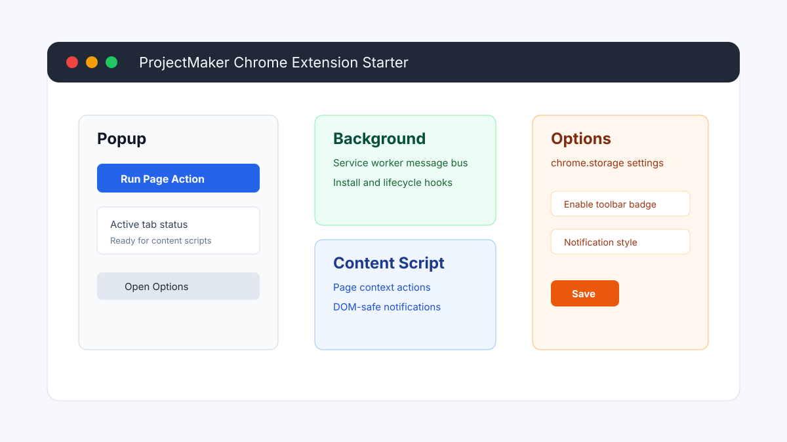

# ChromeExtensionCookieCutter

A ProjectMaker cookiecutter template for Chrome extensions. It generates a Manifest V3 extension with a background service worker, popup UI, options page, active-tab content script, shared modules, local test scripts, and ProjectMaker deployment metadata.

## Requirements

```bash
pip install cookiecutter
```

## Usage

```bash
cookiecutter /path/to/ChromeExtensionCookieCutter
```

## Template Variables

| Variable | Default | Description |
|---|---|---|
| `project_name` | My Chrome Extension | Human-readable project name |
| `project_slug` | `my_chrome_extension` | Generated directory/package slug |
| `project_slug_dashed` | `my-chrome-extension` | Browser-extension package name |
| `extension_name` | `project_name` | Chrome Web Store and toolbar name |
| `extension_short_name` | PM Extension | Short toolbar/display name |
| `extension_description` | General-purpose description | Manifest description |
| `author_name` | Your Name | Package author |
| `author_email` | your@email.com | Package author email |
| `homepage_url` | https://example.com | Manifest homepage URL |

## Generated Structure

```text
<project_slug>/
├── extension/
│   ├── manifest.json
│   ├── background/service-worker.js
│   ├── content/content-script.js
│   ├── popup/
│   ├── options/
│   ├── shared/
│   └── assets/icons/
├── scripts/
│   ├── build.mjs
│   └── validate-extension.mjs
├── projectmaker.yml
├── package.json
└── README.md
```

## Local Development

```bash
cd <project_slug>
npm install
npm run validate
npm run build
```

Then open `chrome://extensions`, enable Developer mode, choose **Load unpacked**, and select the generated `dist/` directory.

## ProjectMaker

The generated `projectmaker.yml` declares build and validation commands. Browser extensions are packaged artifacts rather than web services, so deployment is represented as a static artifact workflow.
